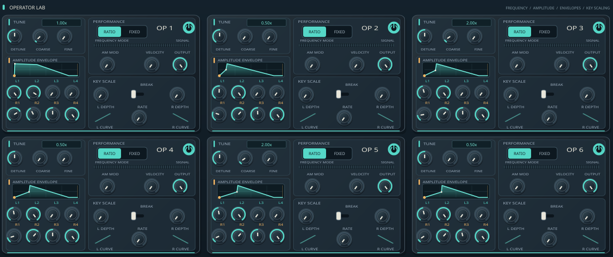
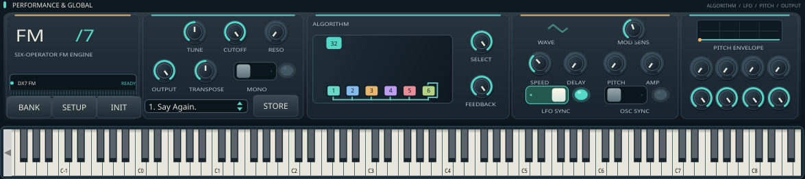

# DX7 FM Synth

**A new instrument-grade interface for classic six-operator FM synthesis.**

DX7 FM Synth is an independent visual and workflow redesign of [Dexed](https://github.com/asb2m10/dexed), the open-source instrument modeled on the Yamaha DX7. It retains Dexed's JUCE/C++ audio engine and DX7-compatible programming concepts while improving the editor's visual hierarchy, tactile controls, program workflow, and readability.

This is **not** Arturia DX7 V, and it is not affiliated with or endorsed by Arturia or Yamaha. Arturia DX7 V is used as a benchmark for clarity and musical usability; its interface art, code, logos, and branding are not included.

[**Download latest UI-Nightly release**](https://github.com/boop-bip80/DX7-FM-synth/releases/tag/UI-Nightly) · [**View build runs**](https://github.com/boop-bip80/DX7-FM-synth/actions/workflows/project-pipeline.yml) · [**Screenshot workflow**](https://github.com/boop-bip80/DX7-FM-synth/actions/workflows/ui-preview.yml) · [**Keyboard shortcuts**](doc/Keybindings.md) · [**UI validation checklist**](doc/DX7_UI_REDESIGN.md)

## The instrument

See detail views: FM operator lab and performance controls

| Six-operator FM lab | Global controls and playable keyboard |
| :---: | :---: |
|  |  |

*Screenshot provenance:* The main image is a **real 1202 × 870 capture of the compiled Linux JUCE standalone**, taken under Xvfb and committed by GitHub Actions—not a design mockup. [Screenshot run 41266055783 passed](https://github.com/boop-bip80/DX7-FM-synth/actions/runs/41266055783) for UI commit `81e4923`; the screenshot was committed in `719ad9e`. The detail images are crops of the same genuine running UI, **not additional screens**. They are populated by the follow-up screenshot workflow run; if a crop is not yet present, download the latest **dx7-ui-screenshots** artifact or inspect the [workflow status](https://github.com/boop-bip80/DX7-FM-synth/actions/workflows/ui-preview.yml).

### What the editor focuses on

- **Six operators in one workspace:** keep the real DX7 operator structure visible instead of hiding the signal path behind many nested dialogs.
- **Graphical envelopes and FM topology:** read envelope shapes and the selected algorithm quickly while retaining the underlying DX7 parameters.
- **A live instrument feel:** graphite panels, fine contrasting labels, sea-glass editing accents, warm signal/activity details, and high-DPI vector controls.
- **Patch and performance workflow:** choose or store voices, import/export DX7 SysEx cartridges, audition through the virtual keyboard, and reach global settings.
- **Existing DAW/MIDI semantics:** preserve host parameter automation, MIDI input, keyboard shortcuts, tuning functions and the processor's existing state handling.

The editor refresh does **not** introduce Arturia-only synthesis features, additional operator waveforms, new effects, or a different audio engine. Existing audio behavior is intentionally preserved.

## Get the latest builds

The newest binaries are built by GitHub Actions from this repository, not the upstream Dexed release page. The [**UI-Nightly release**](https://github.com/boop-bip80/DX7-FM-synth/releases/tag/UI-Nightly) is refreshed on successful Windows, macOS **and** Linux builds. As of [build run 41266055693](https://github.com/boop-bip80/DX7-FM-synth/actions/runs/41266055693), all three OS jobs succeeded and the release includes Linux ZIP, Windows EXE/ZIP and macOS DMG/ZIP downloads. Check the release's displayed upload date and run results for newer revisions.

**About the filename:** installers are still named `Dexed-1.1.0-*`, and the installed plug-in/standalone window still identifies as **Dexed**. That original plug-in identity is intentionally retained for existing DAW project and host compatibility, even though this fork's repository and redesigned interface use DX7 FM Synth branding. This is not an installation mistake.

| Platform | Build output | Where to download |
| --- | --- | --- |
| Windows | Windows installer / plugin bundle | [UI-Nightly download](https://github.com/boop-bip80/DX7-FM-synth/releases/tag/UI-Nightly) or [latest Windows run](https://github.com/boop-bip80/DX7-FM-synth/actions/workflows/project-pipeline.yml?query=branch%3Amaster), artifact **windows-bin** |
| macOS | macOS package and plugin bundle; signing/notarization requirements vary | [UI-Nightly download](https://github.com/boop-bip80/DX7-FM-synth/releases/tag/UI-Nightly) or [latest macOS run](https://github.com/boop-bip80/DX7-FM-synth/actions/workflows/project-pipeline.yml?query=branch%3Amaster), artifact **macos-bin** |
| Linux | Linux installer / plugin bundle | [UI-Nightly download](https://github.com/boop-bip80/DX7-FM-synth/releases/tag/UI-Nightly) or [latest Linux run](https://github.com/boop-bip80/DX7-FM-synth/actions/workflows/project-pipeline.yml?query=branch%3Amaster), artifact **linux-bin** |
| UI screenshots | Captured Linux standalone PNG(s) | [UI preview runs](https://github.com/boop-bip80/DX7-FM-synth/actions/workflows/ui-preview.yml?query=branch%3Amaster), artifact **dx7-ui-screenshots** |

Open the latest **successful** workflow run, scroll to **Artifacts**, and download the package for your OS. Artifacts can expire and may require a GitHub sign-in. A green badge indicates only that workflow completed; for DAW compatibility and audio behavior, consult the verification notes below. A workflow's existence is **not** proof that it has passed.

The rolling tag is a **pre-release**, not a claim of production certification or DAW validation. A release should be treated as current only if its published source commit matches the revision you intend to run.

## How to play and edit

1. Open the standalone synth or load the built instrument plug-in in a compatible host.
2. Select a voice using the program selector, or load a DX7 SysEx cartridge from the library manager.
3. Edit one or more of the six operators—frequency ratio, level, envelope and scaling controls—and watch the algorithm routing.
4. Use the global performance section and the on-screen keyboard or a connected MIDI keyboard to audition.
5. Store or export voices using the existing cartridge and program controls.

Some editing features and host interactions are inherited from Dexed; see the [upstream manual](https://asb2m10.github.io/dexed/) for background. For the supported shortcuts, see [doc/Keybindings.md](doc/Keybindings.md).

## Build from source

This is a **CMake + JUCE** C++ project. The required dependencies are Git submodules.

~~~bash
git clone https://github.com/boop-bip80/DX7-FM-synth.git
cd DX7-FM-synth
git submodule update --init --recursive

cmake -S . -B build -DCMAKE_BUILD_TYPE=Release -DJUCE_COPY_PLUGIN_AFTER_BUILD=FALSE
cmake --build build --config Release --parallel 4
~~~

The primary CMake targets produce **Standalone**, **VST3**, **CLAP**, and on macOS **AU**, as configured in source/CMakeLists.txt. Built bundles appear under build/source/Dexed_artefacts (layout may differ by generator). For installer packaging, the CI pipeline uses the separate **installer** target.

On Linux, install system libraries for ALSA, X11, FreeType, OpenGL, WebKit, JACK, and libsndfile as appropriate for your distribution. The [Linux CI job](.github/workflows/project-pipeline.yml) gives the exact Ubuntu package list. For local debugging, omit installation/copying into system plug-in directories until you have a successful build.

## Current verification

| Check | Evidence |
| --- | --- |
| Native CI compile / installer output | **Passed** for Linux, Windows and macOS at `81e4923`; [successful build run 41266055693](https://github.com/boop-bip80/DX7-FM-synth/actions/runs/41266055693) |
| Linux standalone GUI launch and main screenshot | **Passed**, 1202 × 870 real capture; [successful screenshot run 41266055783](https://github.com/boop-bip80/DX7-FM-synth/actions/runs/41266055783) |
| Operator/performance cropped screenshot gallery | Same captured screen; [latest capture run](https://github.com/boop-bip80/DX7-FM-synth/actions/workflows/ui-preview.yml) must finish and commit both crops before considering them verified |
| Layout usability and keyboard behavior | **Not yet verified manually**; [manual UX gate checklist](doc/DX7_UI_REDESIGN.md#completion-checklist) |
| DSP, SysEx, host automation, accessibility | Need separate functional/manual verification; a UI screenshot alone does not establish correctness |

The definitive current result is the workflow status for the commit being inspected. Failures, skipped jobs and missing screenshots should be treated as incomplete work, not silently counted as passing.

## Development status and scope

- The maintained default branch is **master**. Changes to the redesigned interface, CI workflows and this documentation are tracked there.
- The redesign is scoped to the JUCE view/editor, look-and-feel, program browsing and graphic parameter displays. Audio generation remains based on the inherited DX7-oriented engine.
- The [design and validation document](doc/DX7_UI_REDESIGN.md) records the appearance rationale and the precise checks required before claiming the UI is production-ready.
- Need a different visual treatment? Please open an [issue](https://github.com/boop-bip80/DX7-FM-synth/issues) with the host, OS, scaling setting and screenshot. For a behavioral regression, include reproduction steps and the workflow/commit SHA.

## Acknowledgments and license

This repository is a modified fork of [Dexed by Pascal Gauthier and contributors](https://github.com/asb2m10/dexed), GPL-3.0-or-later; see [LICENSE](LICENSE). The music-synthesizer-for-android / msfa component retains its Apache-2.0 licensing. It uses [JUCE](https://juce.com/), contributions from the [Surge Synth Team](https://surge-synth-team.org/) and [MTS-ESP](https://oddsound.com/).

Credit for Dexed's original artwork belongs to its respective creators, including AZur Studio. New editor styling in this fork is an independent project direction; preserving upstream credit does not imply endorsement. Yamaha and DX7 are marks of their respective owner. Arturia and DX7 V are marks of Arturia; no proprietary Arturia assets are bundled.

For technical history and long-standing DSP improvements, follow [upstream Dexed's changelog](https://github.com/asb2m10/dexed) rather than treating old upstream release notes as this fork's new work.
