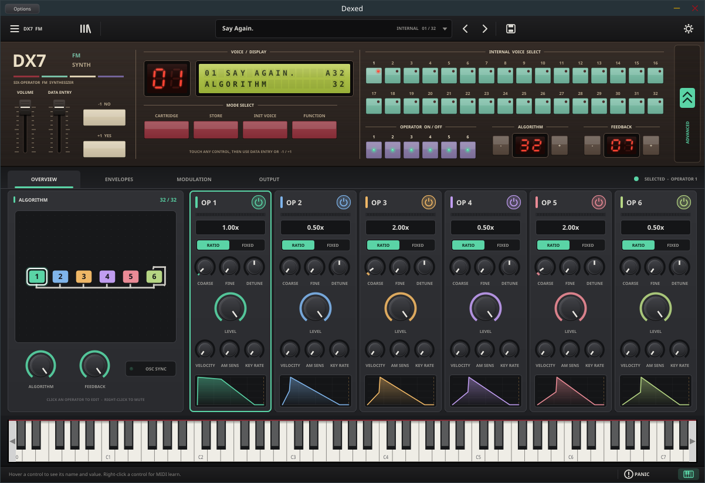
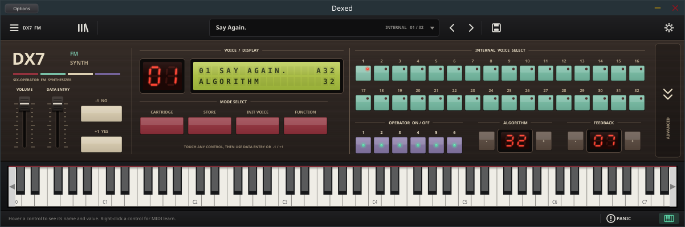
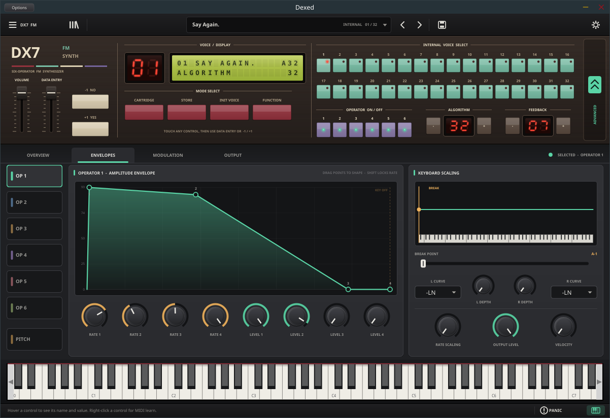
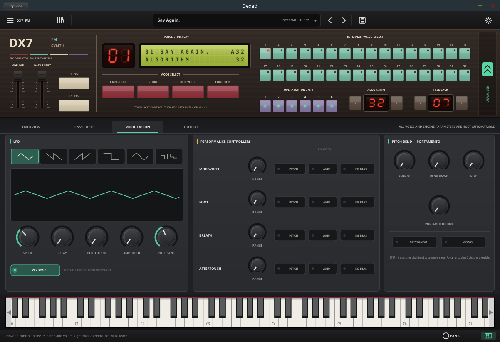
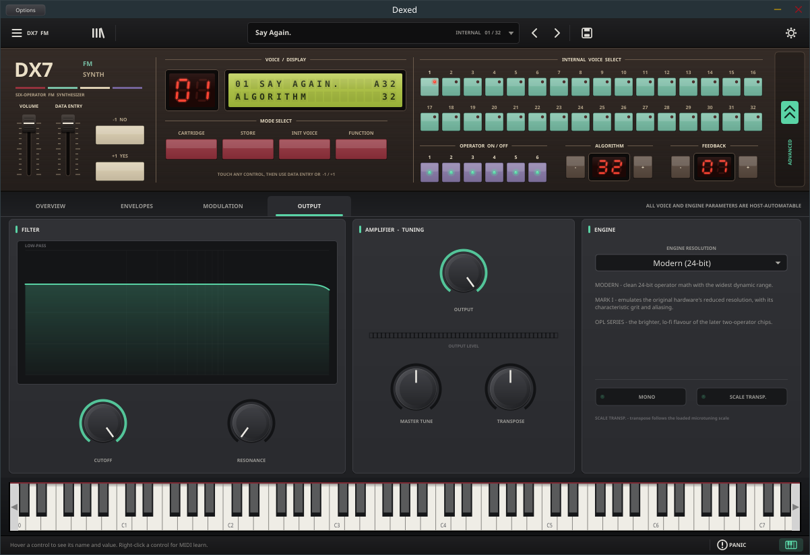

# DX7 FM Synth

**A classic six-operator FM front panel with a modern, fold-out editing workspace.**

DX7 FM Synth is a fork of [Dexed](https://github.com/asb2m10/dexed), the open-source instrument modelled on the Yamaha DX7, with a completely redesigned editor. It keeps Dexed's JUCE/C++ audio engine, its DX7 SysEx compatibility and every voice parameter. The editor itself is rebuilt around the two-level workflow of modern hardware emulations: a vintage front panel you play like the original keyboard, with an advanced workspace that folds out underneath for deep editing.

**Design reference and originality:** the layout and workflow take the *interaction model* of Arturia's DX7 V as their reference: a classic panel on top, a fold-out advanced section, a top toolbar and a bottom status bar. No Arturia artwork, photographs, logos, fonts, code or product names are used; every pixel is drawn by vector code in this repository. This project is not affiliated with or endorsed by Arturia or Yamaha.

[**Download the latest UI-Nightly build**](https://github.com/boop-bip80/DX7-FM-synth/releases/tag/UI-Nightly) · [**Build runs**](https://github.com/boop-bip80/DX7-FM-synth/actions/workflows/project-pipeline.yml) · [**Screenshot runs**](https://github.com/boop-bip80/DX7-FM-synth/actions/workflows/ui-preview.yml) · [**Keyboard shortcuts**](doc/Keybindings.md) · [**Design spec**](doc/DX7_UI_REDESIGN.md)

## The instrument

*Overview tab: the clickable algorithm chart and six colour-coded operator strips beneath the classic front panel.*

| Classic panel (workspace folded) | Envelopes |
| :---: | :---: |
|  |  |
| **Modulation** | **Output** |
|  |  |

*Screenshot provenance:* every image is a capture of the **actual compiled Linux JUCE standalone** running under Xvfb, not a mock-up. [`capture-ui.sh`](.github/workflows/capture-ui.sh) launches the app, clicks the real tabs and the ADVANCED fold, and captures each view. The [screenshot workflow](https://github.com/boop-bip80/DX7-FM-synth/actions/workflows/ui-preview.yml) repeats this on every UI change to `master`, commits refreshed images, and also uploads them as the **dx7-ui-screenshots** artifact.

## UI / UX tour

### Upper toolbar
- **Main menu** (☰ DX7 FM): initialise, store, send the voice to a DX7, the cartridge library, .syx export, settings and tuning, workspace and keyboard visibility, UI-scale reset, About.
- **Library** (bars icon): the cartridge browser for DX7 SysEx banks.
- **Preset field**: voice name, cartridge and position. Click it for the full voice list, scroll over it to step through voices, or use the ‹ › arrows.
- **Store** (disk) and **Settings** (gear): MIDI, controller assignments, tuning and UI scaling.

### Classic front panel
- **VOLUME** fader and **DATA ENTRY** fader with **−1 NO / +1 YES** buttons. Touch any control anywhere in the editor and the LCD shows its name and value; the data-entry fader and buttons then edit it, as on the original hardware.
- **Red LED** voice number and a **two-line backlit LCD** showing the voice, algorithm and selected parameter.
- **Mode switches**: CARTRIDGE, STORE, INIT VOICE and FUNCTION.
- **32 voice-select membrane switches**: one click recalls any voice of the loaded cartridge, and the lit switch tracks host program changes.
- **Operator on/off** switches, plus **algorithm** and **feedback** steppers with LED readouts.
- The **ADVANCED** tab on the right folds the workspace in or out (or press Ctrl+E). The setting is remembered.

### Advanced workspace
- **Overview**: an interactive algorithm chart (click an operator to select it, right-click to mute it), algorithm and feedback knobs, oscillator sync, and six operator strips. Each strip has a power switch, activity meter, frequency readout, ratio/fixed switch, coarse, fine, detune, level, velocity, AM sensitivity, key rate scaling and a mini envelope you can click to open.
- **Envelopes**: OP 1–6 and PITCH pages with a large envelope whose points you **drag** (vertical = level, horizontal = rate, Shift = level only). Eight rate/level knobs sit below it. The keyboard-scaling graph shows the break point and left/right curves on a miniature keyboard.
- **Modulation**: LFO waveform buttons and a live shape preview, including the delay ramp. Speed, delay, pitch and amp depth, pitch sensitivity and key sync. Mod wheel, foot, breath and aftertouch ranges with pitch/amp/EG-bias routing. Pitch-bend range and step, portamento, glissando and mono mode.
- **Output**: filter response curve with cutoff and resonance, output level and meter, master tune, transpose, and engine resolution (Modern 24-bit, Mark I, OPL series).

### Lower status bar and keyboard
- The **status bar** shows the name and live value of the control under the pointer. It also has **PANIC** (all notes off) and the **keyboard** toggle.
- Knob captions turn into value readouts while you hover or drag. Double-click a knob to reset it; right-click it for MIDI learn.
- The on-screen **keyboard** spans the full width and can be hidden.

Everything is vector-drawn, scales with the UI-zoom setting, and stays bound to the same host-automatable parameters as before. The editor redesign does **not** add Arturia-only synthesis features, extra waveforms, effects or a different audio engine; audio behaviour is unchanged.

## Get the latest builds

Binaries are built by GitHub Actions from this repository. The [**UI-Nightly release**](https://github.com/boop-bip80/DX7-FM-synth/releases/tag/UI-Nightly) is refreshed automatically, but only after the Windows, macOS **and** Linux builds of a `master` commit all succeed. The release notes name the exact source commit. Check that it matches the revision you intend to run.

| Platform | Build output | Where to download |
| --- | --- | --- |
| Windows | Installer (.exe) and plug-in ZIP: Standalone, VST3, CLAP | [UI-Nightly](https://github.com/boop-bip80/DX7-FM-synth/releases/tag/UI-Nightly) or artifact **windows-bin** of the [latest run](https://github.com/boop-bip80/DX7-FM-synth/actions/workflows/project-pipeline.yml?query=branch%3Amaster) |
| macOS | DMG and ZIP: Standalone, VST3, AU, CLAP (may be unsigned) | [UI-Nightly](https://github.com/boop-bip80/DX7-FM-synth/releases/tag/UI-Nightly) or artifact **macos-bin** of the [latest run](https://github.com/boop-bip80/DX7-FM-synth/actions/workflows/project-pipeline.yml?query=branch%3Amaster) |
| Linux | ZIP: Standalone, VST3, CLAP | [UI-Nightly](https://github.com/boop-bip80/DX7-FM-synth/releases/tag/UI-Nightly) or artifact **linux-bin** of the [latest run](https://github.com/boop-bip80/DX7-FM-synth/actions/workflows/project-pipeline.yml?query=branch%3Amaster) |
| UI screenshots | Live Linux standalone captures (PNG) | Artifact **dx7-ui-screenshots** of the [screenshot runs](https://github.com/boop-bip80/DX7-FM-synth/actions/workflows/ui-preview.yml?query=branch%3Amaster) |

**About the filename:** installers are still named `Dexed-1.1.0-*`, and the installed plug-in and standalone window still identify as **Dexed**. That identity is kept deliberately so existing DAW projects and hosts keep finding the plug-in. This is not an installation mistake.

UI-Nightly is a rolling **pre-release**, not a claim of production certification or DAW validation. Workflow artifacts can expire and may require a GitHub sign-in.

## How to play and edit

1. Open the standalone app or load the plug-in in a compatible host.
2. Pick a voice with the 32 voice-select switches or the preset field, or load a DX7 SysEx cartridge from the library.
3. For quick edits, touch a control and use DATA ENTRY or −1/+1. For deep edits, unfold the advanced workspace and use the Overview and Envelopes tabs.
4. Shape vibrato and controller response on the Modulation tab; set filter, tuning and engine character on the Output tab.
5. Store the voice or export the cartridge from the main menu.

Some editing features and host interactions are inherited from Dexed; see the [upstream manual](https://asb2m10.github.io/dexed/) for background. The supported shortcuts and mouse gestures are listed in [doc/Keybindings.md](doc/Keybindings.md).

## Build from source

This is a **CMake + JUCE** C++ project. The dependencies are Git submodules.

~~~bash
git clone https://github.com/boop-bip80/DX7-FM-synth.git
cd DX7-FM-synth
git submodule update --init --recursive

cmake -S . -B build -DCMAKE_BUILD_TYPE=Release -DJUCE_COPY_PLUGIN_AFTER_BUILD=FALSE
cmake --build build --config Release --parallel 4
~~~

The CMake targets produce **Standalone**, **VST3**, **CLAP** and, on macOS, **AU**, as configured in `source/CMakeLists.txt`. Built bundles appear under `build/source/Dexed_artefacts` (the layout may differ by generator). The CI pipeline uses the separate **installer** target for packaging.

On Linux, install the ALSA, X11, FreeType, OpenGL, GTK, JACK and libsndfile development packages for your distribution. The [Linux CI job](.github/workflows/project-pipeline.yml) gives the exact Ubuntu package list.

## Verification

| Check | Evidence |
| --- | --- |
| Linux standalone compiles with GCC and Clang, launches, and renders every tab | Real Xvfb captures in [`docs/screenshots`](docs/screenshots), produced by clicking through the live app |
| Scripted interaction smoke test | Voice select, data entry +1, envelope point drag, algorithm-chart mute, library and settings dialogs respond as intended |
| Windows / macOS / Linux packages and UI-Nightly publication | See the [build pipeline runs](https://github.com/boop-bip80/DX7-FM-synth/actions/workflows/project-pipeline.yml?query=branch%3Amaster) for the commit being inspected |
| DAW hosting, SysEx round-trips, audio behaviour, accessibility | Need separate manual verification; a screenshot alone does not establish correctness. See the [checklist](doc/DX7_UI_REDESIGN.md#completion-checklist) |

Treat failed, skipped or missing jobs as incomplete work, not as passing.

## Acknowledgments and license

This repository is a modified fork of [Dexed by Pascal Gauthier and contributors](https://github.com/asb2m10/dexed), GPL-3.0-or-later; see [LICENSE](LICENSE). The music-synthesizer-for-android (msfa) component keeps its Apache-2.0 licence. It uses [JUCE](https://juce.com/), contributions from the [Surge Synth Team](https://surge-synth-team.org/) and [MTS-ESP](https://oddsound.com/).

Credit for Dexed's original artwork belongs to its creators, including AZur Studio. The new editor in this fork is an independent design drawn in code; preserving upstream credit does not imply endorsement. Yamaha and DX7 are trademarks of Yamaha Corporation. Arturia and DX7 V are trademarks of Arturia. No proprietary Arturia or Yamaha assets are included.

For technical history and long-standing DSP improvements, see [upstream Dexed](https://github.com/asb2m10/dexed).
